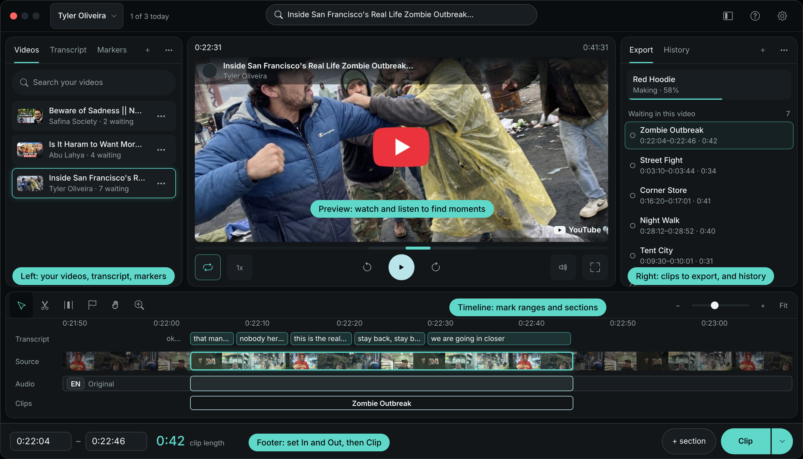

<div align="center">


# Clipr

**Only the seconds you need.**

Stop downloading two-hour videos for forty seconds. Paste a link, mark the
moments, and Clipr downloads just those, ready for Final Cut Pro, Premiere
Pro, DaVinci Resolve or CapCut. No ads, no account, and nothing is uploaded.
Several moments can come down as one joined file.

[](https://github.com/xxxxxLiam/clipr/releases/latest)
[](https://github.com/xxxxxLiam/clipr/releases)


### [⬇&nbsp; Download Clipr](https://xxxxxliam.github.io/clipr/)

<sub>Picks the right file for your computer and walks you through first launch<br/>
macOS, Windows and Linux · free, no ads, no account · <a href="#install">or pick a file yourself</a></sub>

</div>

<p align="center">
  
</p>

---

## What it does

The job is not one clip. It is: pick a campaign, scan a transcript, find the
moments worth cutting, check you have not already used them, pull one or
several ranges into one file, and hand clean text to whatever comes next.
Clipr is shaped around that loop rather than around a single download.

| | |
|---|---|
| **One file, several moments** | Mark 1:00–2:00 and 10:00–11:00 and get **one** download containing both, joined in order. |
| **Only the part you mark** | Set in and out. Clipr fetches that section and nothing else, so a two-hour podcast costs you seconds. Clips run up to 10 minutes each. |
| **Transcript-first** | Read the transcript to find the moment and jump straight to it. Long transcripts stay responsive — only what you can see is drawn. |
| **Campaigns** | Several clients a day, each with its own folders, naming and clip bank. Nothing crosses between them. |
| **Clip bank** | Import a block of timestamps once per video, categorise them, give them tiers, and work down the list. |
| **Used-range memory** | Clipr remembers what you have already cut and marks it on the transcript, so you do not ship the same moment twice. |
| **Editor handoff** | Pick Final Cut Pro, Premiere Pro, DaVinci Resolve or CapCut in the Clip menu. Final Cut (Mac only) gets the clip in a named library and event, with a project made for you. The others open with the file shown in Finder or File Explorer, ready to drop in. |
| **Copy blocks** | Title, description, timestamps and the rest, each one click away. |
| **Symbol palette** | Honorifics and other symbols that are a nuisance to type, copied exactly. |

<p align="center">
  
</p>

<p align="center"><sub>Two moments from different parts of the same interview, joined: the gap folds away and they go out as one 0:34 file.</sub></p>

Everything runs on your machine. Nothing is uploaded anywhere.

## Install

<table>
<tr>
<td width="33%" valign="top">

**macOS**

[Download .dmg](https://github.com/xxxxxLiam/clipr/releases/latest/download/Clipr-macOS-AppleSilicon.dmg)

For Apple Silicon Macs (M1, M2, M3 or newer); it does not run on Intel Macs. Apple menu → About This Mac shows which you have: "Chip: Apple M…" works, "Processor: Intel" does not. Drag to Applications, then run one Terminal line — below.

</td>
<td width="33%" valign="top">

**Windows**

[Download .exe](https://github.com/xxxxxLiam/clipr/releases/latest/download/Clipr-Windows-x64-Setup.exe)

Right-click the file → Properties → tick **Unblock** before running it. Details below.

</td>
<td width="33%" valign="top">

**Linux**

[Download .AppImage](https://github.com/xxxxxLiam/clipr/releases/latest/download/Clipr-Linux-x64.AppImage)

`chmod +x` it, then run it, or allow it to run as a program in your file manager.

</td>
</tr>
</table>

Your computer doesn't recognise Clipr's publisher yet, so it will warn you
the first time. That warning means "I don't know who made this", not "this
is harmful".

**macOS — the one Terminal line.** Once Clipr is in Applications, open
Terminal (<kbd>⌘</kbd><kbd>Space</kbd>, type *terminal*) and paste:

```
xattr -dr com.apple.quarantine /Applications/Clipr.app && open /Applications/Clipr.app
```

That clears the "downloaded from the internet" flag and opens Clipr straight
away. From then on, double-click it like anything else.

Right-click → Open, which you may have been told to use, no longer works —
Apple removed that shortcut in Sequoia (15). If you'd rather not touch
Terminal at all, let macOS refuse the app once, then go to **System Settings
→ Privacy & Security** and click **Open Anyway**.

**Windows: if your browser blocks the download**, press
<kbd>Ctrl</kbd>+<kbd>J</kbd>, click the `⋯` next to the file and choose
**Keep**. That step catches most people out, because it happens before the
file ever reaches your disk.

**Windows: if there is no Unblock tick box**, some versions hide it. Open
PowerShell and run this instead, then run the installer:

```
Get-ChildItem "$env:USERPROFILE\Downloads\Clipr-Windows-x64-Setup*.exe" | Unblock-File
```

The `*` also catches a copy your browser renamed, like `Setup (1).exe`. Change
`Downloads` if you saved the file somewhere else. If a blue screen then says
"Windows protected your PC", click **More info**, then **Run anyway**.

**Linux:**

```
chmod +x Clipr-Linux-x64*.AppImage && ./Clipr-Linux-x64*.AppImage
```

**Updates.** On Windows and Linux, Clipr updates itself in place — you
download once. On macOS it checks for new versions and hands you a download
link instead, because updating in place requires a signed app and Clipr is
not signed yet. So Mac users re-download each version; it's two clicks, and
the app tells you when there's one.

## Getting 1080p

YouTube serves 360p to anyone who is not signed in. Clipr asks once for a
`cookies.txt` exported from your own browser, and walks you through it. The
file stays on your computer and is never uploaded.

You can skip it and work at 360p. The bar at the bottom of the window says
"at 360p" while you are, and its **Sign in for 1080p** button opens the steps
whenever you are ready. There is no quality setting to pick: clips come down at
1080p, or the highest the video has.

## Something went wrong?

In Clipr, open **Help** (the **?** at the top right), choose
**Report a problem**, write what you were doing in plain words and press
**Send report**. *"It got to 90% and said export failed"* is a genuinely useful report. Clipr
adds the error, the version numbers and a cleaned-up log, and nothing is sent
unless you press **Send report**. You do not need an account of any kind.

If a crash screen appears, it has the same **Send report** button, plus **Copy
details** if you would rather pass the details on yourself.

## Licence

**Free to download and use, including for paid client work.** The clips you
make are yours.

Not open source: copying, redistributing, forking or reselling the
application is not permitted. See [LICENSE](LICENSE).

Clipr is published by **IDK Solutions (Pty) Ltd**, registered in South Africa
(CIPC registration number 2022/757534/07). Earlier versions, released as
*YouTube Clipper* up to 4.0.1, remain under the MIT licence they shipped
with.

Clipr ships alongside **ffmpeg**, which is licensed under the GPL v3 and
carries its own terms that this licence does not override. See
[THIRD-PARTY-NOTICES.md](THIRD-PARTY-NOTICES.md) for the full component list
and for how to obtain corresponding source.

<div align="center">
<sub>This repository holds the downloads. The source is kept separately.</sub>
</div>
