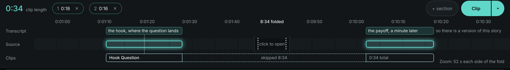

<div align="center">


# Clipr

**Pull the moments you want out of a long video, ready to edit.**

A desktop downloader for clippers: paste a link, read the transcript to find
the moment, mark in and out, download just that. Several moments can come
down as one joined file. The editing happens in Final Cut, CapCut or
Premiere — Clipr's job is to get you there with the right footage and the
right text, fast.

[](https://github.com/xxxxxLiam/clipr/releases/latest)
[](https://github.com/xxxxxLiam/clipr/releases)


### [⬇&nbsp; Download Clipr](https://xxxxxliam.github.io/clipr/)

<sub>Picks the right file for your computer and walks you through first launch<br/>
macOS, Windows and Linux · no account, no sign-up · <a href="#install">or pick a file yourself</a></sub>

</div>

<p align="center">
  
</p>

---

## What it does

The job is not one clip. It is: pick a campaign, scan a transcript, find the
moments worth cutting, check you have not already used them, pull one or
several ranges into one file, and hand clean text to whatever comes next.
Clipr is shaped around that loop rather than around a single download.

| | |
|---|---|
| **Transcript-first** | Read the transcript to find the moment and jump straight to it. Long transcripts stay responsive — only what you can see is drawn. |
| **One file, several moments** | Mark 1:00–2:00 and 10:00–11:00 and get **one** download containing both, joined in order. |
| **Campaigns** | Several clients a day, each with its own folders, naming and clip bank. Nothing crosses between them. |
| **Clip bank** | Import a block of timestamps once per video, categorise them, give them tiers, and work down the list. |
| **Used-range memory** | Clipr remembers what you have already cut and marks it on the transcript, so you do not ship the same moment twice. |
| **Editor handoff** | Send a download into a named Final Cut library and event, with the project created for you on a vertical 1080×1920 timeline, ready to reframe. CapCut too. Premiere Pro is coming. |
| **Copy blocks** | Title, description, timestamps and the rest, each one click away. |
| **Symbol palette** | Honorifics and other symbols that are a nuisance to type, copied exactly. |

<p align="center">
  
</p>

<p align="center"><sub>Two moments from different parts of the same interview, going out as one file &mdash; and a warning that part of the second was already published.</sub></p>

Everything runs on your machine. Nothing is uploaded anywhere.

## Install

<table>
<tr>
<td width="33%" valign="top">

**macOS**

[Download .dmg](https://github.com/xxxxxLiam/clipr/releases/latest/download/Clipr-macOS-AppleSilicon.dmg)

Apple Silicon. Drag to Applications, then run this once in Terminal:

```
xattr -dr com.apple.quarantine /Applications/Clipr.app
```

</td>
<td width="33%" valign="top">

**Windows**

[Download .exe](https://github.com/xxxxxLiam/clipr/releases/latest/download/Clipr-Windows-x64-Setup.exe)

Right-click the file → Properties → tick **Unblock** before running it.

</td>
<td width="33%" valign="top">

**Linux**

[Download .AppImage](https://github.com/xxxxxLiam/clipr/releases/latest/download/Clipr-Linux-x64.AppImage)

`chmod +x` it, then run it.

</td>
</tr>
</table>

Clipr is not signed with a paid certificate yet, so your computer will warn
you the first time. That warning means "we cannot verify who published this",
not "this is dangerous".

**macOS:** right-click → Open no longer works — Apple removed that shortcut in
Sequoia (15). The Terminal line above is the step that actually works; it
clears the "downloaded from the internet" flag on Clipr and nothing else. If
you'd rather not touch Terminal, let macOS refuse the app once, then go to
**System Settings → Privacy & Security** and click **Open Anyway**.

**Windows: if your browser blocks the download**, press
<kbd>Ctrl</kbd>+<kbd>J</kbd>, click the `⋯` next to the file and choose
**Keep**. That step catches most people out, because it happens before the
file ever reaches your disk.

**Updates.** On Windows and Linux, Clipr updates itself in place — you
download once. On macOS it checks for new versions and hands you a download
link instead, because updating in place requires a signed app and Clipr is
not signed yet. So Mac users re-download each version; it's two clicks, and
the app tells you when there's one.

## Getting 1080p

YouTube serves 360p to anyone who is not signed in. Clipr asks once for a
`cookies.txt` exported from your own browser, and walks you through it. The
file stays on your computer and is never uploaded.

You can skip it and work at 360p — the header always says which you are
getting, and you can sign in later from the status chip.

## Something went wrong?

Say so. You don't need to be technical about it — *"it got to 90% and said
export failed"* is a genuinely useful report.

<div align="center">

### [🛟&nbsp; Report a problem](https://github.com/xxxxxLiam/clipr/issues/new/choose)

</div>

That opens a short form with the questions already in it. It asks three
things:

1. **What you were trying to do**, in plain words.
2. **What happened instead.** You can drag a screenshot or a screen recording
   straight into the box if that's easier than describing it.
3. **Diagnostics**, if Clipr offered them.

On that last one: when an error appears, look for a **Copy diagnostics**
button next to it. Click it, then paste into the form. That single paste is
worth more than everything else combined — it records the exact version and
the exact point things failed, so the problem can be found without a
back-and-forth. Cookies, sign-in tokens and your personal file paths are
stripped out before it copies, so it's safe to post in public. If there's no
button next to your error, skip it; it isn't offered for every failure.

Posting needs a free GitHub account — it's a minute to make, and it's how
replies reach you.

## Licence

**Free to download and use, including for paid client work.** The clips you
make are yours.

Not open source: copying, redistributing, forking or reselling the
application is not permitted. See [LICENSE](LICENSE).

Clipr is published by **IDK Solutions (Pty) Ltd**, registered in South Africa
(CIPC registration number 2022/757534/07). Earlier versions, released as
*YouTube Clipper* up to 4.0.1, remain under the MIT licence they shipped
with.

Clipr ships alongside **ffmpeg**, which is licensed under the GPL v3 and
carries its own terms that this licence does not override. See
[THIRD-PARTY-NOTICES.md](THIRD-PARTY-NOTICES.md) for the full component list
and for how to obtain corresponding source.

<div align="center">
<sub>This repository holds the downloads. The source is kept separately.</sub>
</div>
